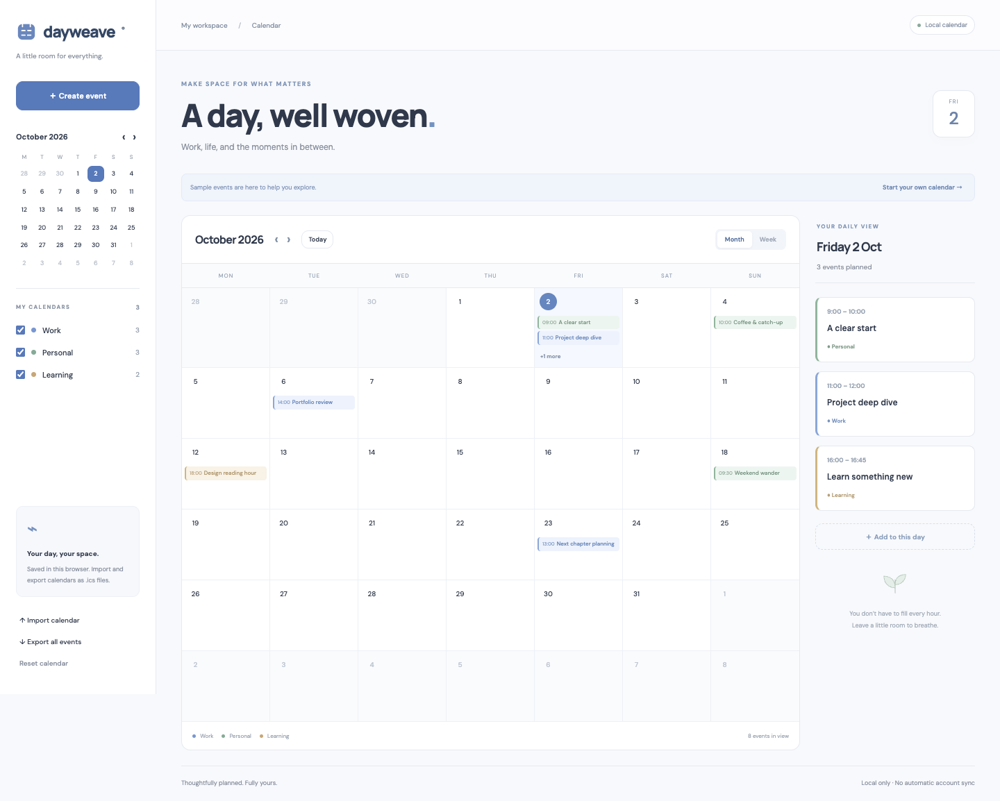

# Dayweave

[Open live app](https://mohdriyaazpersonal.github.io/dayweave/)



A calm calendar for work, life, and learning. Plan in connected month and week views, browse a daily agenda, and move events between calendar apps using iCalendar files.

## Run

Requires Node.js 22 or newer. No dependency installation is needed.

```sh
npm start
# Open http://localhost:4173
npm test
npm run build
```

`npm run build` creates a static `dist/` folder for any static host. Set `PORT=3002 npm start` to use another port locally.

## Features

- Connected month/week views, date selection, Today navigation, and mini calendar.
- Event creation, editing, deletion, locations, notes, and multi-day events.
- Work, Personal, and Learning calendars with visibility filters.
- Daily agenda and event counts that follow selected calendars.
- All-day events with standard exclusive end dates.
- ICS import with line unfolding, escaped text, UTC/local times, and validation.
- ICS export with UTF-8-aware line folding, stable UIDs, and calendar categories.
- Imported events merge by UID after confirmation; matching events are updated.
- Local browser persistence, labeled demo events, and reset controls.
- Responsive layout, keyboard-accessible controls, and native dialogs.

## Supported ICS format

Import supports basic `VEVENT` records with `DTSTART`, optional `DTEND` (default one hour or one day), `SUMMARY`, `DESCRIPTION`, `LOCATION`, and `UID`. Floating local times and UTC `Z` times are accepted. UTC times are converted to the device’s local time zone. All-day `VALUE=DATE` dates are supported. Alarm properties are ignored. Unknown ordinary metadata is ignored. The app exports all events, including hidden categories.

Recurring events (`RRULE`, `RDATE`, `EXDATE`, `RECURRENCE-ID`), named time zones other than UTC, and `DURATION` are rejected with an explanation. These files are rejected as a whole, so unsupported recurring events are not silently flattened. Export individual instances with explicit start/end times before importing them. Files are limited to 5 MB and 2,000 imported events. Times are stored at minute precision.

## Privacy and limitations

Data lives only in this browser’s localStorage. There is no automatic Google/Outlook sync, account connection, notification delivery, or server storage. Export your calendar before clearing browser data or changing devices. Because local date-times are stored, changing the device time zone changes how floating times are interpreted. Google Fonts provides optional typography; system fonts work offline. Sample events are clearly labeled and can be cleared.

## Tests

The Node test suite covers invalid dates, event ranges, Monday-first grids, multi-day and exclusive-end behavior, calendar filters, ICS text/time round-trips, Unicode folding, default end dates, UTC conversion, alarm handling, and unsupported format rejection.

## Inspiration

Code inspired by the [Create a connected calendar](https://app.joinhandshake.com/learn/create-a-connected-calendar-0e0b0681) learning mission and built with Codex. This project makes no claim that a Handshake mission was completed or submitted.

MIT licensed. See `LICENSE`.
